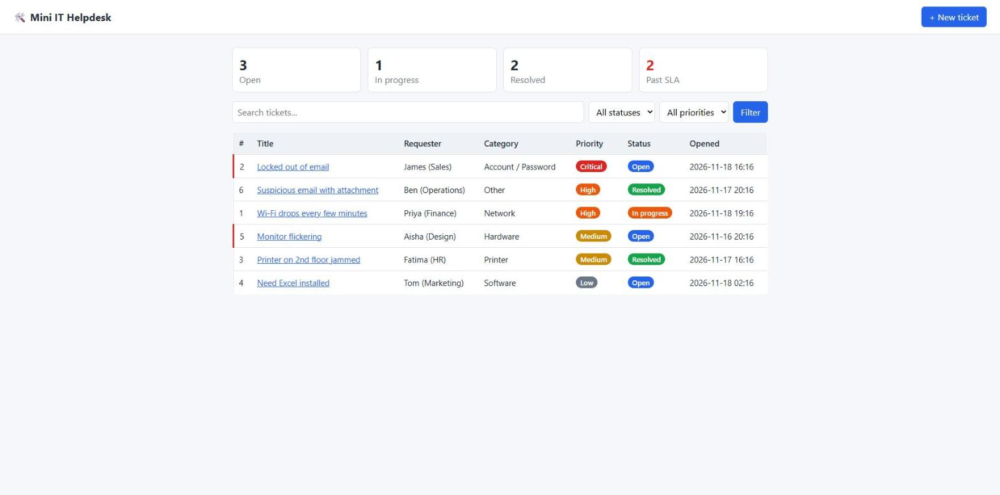
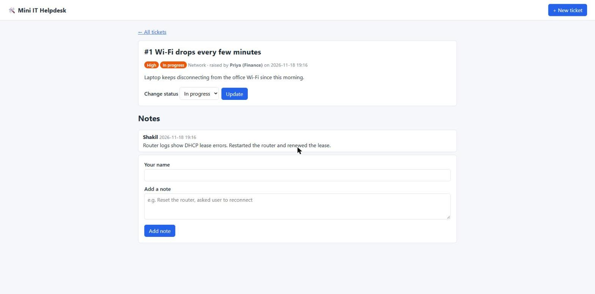

# Mini IT Helpdesk

A small IT support ticketing web app built with **Python, Flask and SQLite**. Staff log IT problems, and support triages them by priority, moves them through **Open → In progress → Resolved**, and keeps notes on each fix.

I built it because I've been the unofficial IT support for my family, my classmates and my father's restaurant for years. This is the tool I wish I'd had to keep track of it all.





## Features

- **Log tickets** with category (Hardware, Network, Account / Password…) and priority
- **Dashboard** with counts for Open, In progress, Resolved and past-SLA tickets
- **SLA tracking:** each priority has a response target (Critical 4h, High 8h, Medium 24h, Low 72h), and overdue tickets are flagged red
- **Search and filters** by status, priority or keyword
- **Notes timeline** on each ticket, with automatic notes when the status changes
- **Input validation** and friendly error messages
- **SQL-injection safe:** every query uses parameterised `?` placeholders
- **9 automated tests** using Flask's test client

## Run it locally

```bash
pip install -r requirements.txt
python seed.py      # optional: load 6 demo tickets
python app.py       # open http://127.0.0.1:5000
```

## Run the tests

```bash
python -m unittest -v
```

## Project structure

```
app.py            Flask app: routes, database, SLA logic
seed.py           Loads demo tickets
templates/        Jinja2 HTML templates
static/style.css  Styling (responsive, works on mobile)
test_app.py       Automated tests
```

## How it works

- `create_app()` uses the **application factory** pattern, so tests can run against a temporary database.
- Tickets and notes live in two SQLite tables linked by a foreign key.
- The ticket list sorts by urgency (Critical first), then by age, so the most important work is always at the top.

## What I learned

- Building a web app with routes, forms, templates and a database
- Why parameterised queries matter, and testing that a SQL-injection attempt fails
- Writing tests for a web app without starting a real server
- Thinking like a service desk: priorities, SLAs and keeping a record of every fix

## Ideas for next steps

- Log-in for support staff vs. normal users
- Email notification when a ticket is updated
- Deploy online (e.g. Render or PythonAnywhere)
